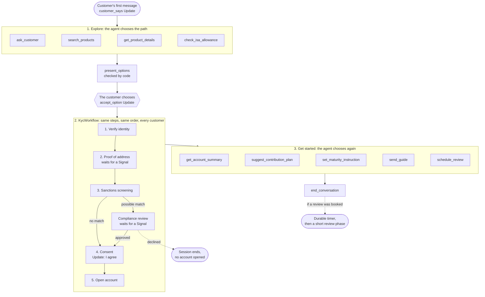
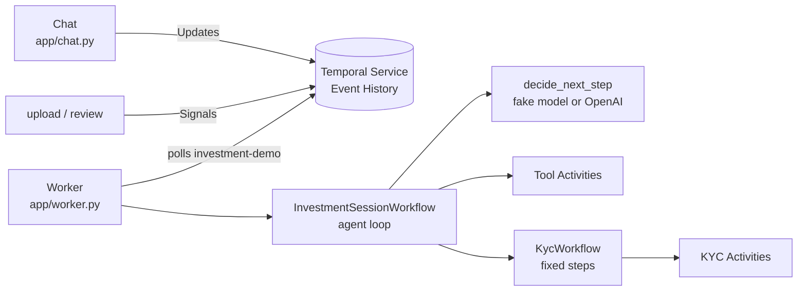

# Hybrid Workflows: an AI agent with fixed KYC steps on Temporal

In a "hybrid workflow", an AI model decides part of the path at runtime, and
code fixes the rest. The model's part suits open conversations, but regulated
onboarding must run the same checks in
the same order for everyone, and survive a crash. This repo does both in one
Temporal Workflow, for a made-up UK investment firm.

- **The dynamic part:** the agent decides the path.
  - **Agent loop:** the model picks one tool at a time until it calls the tool
    that ends the phase. Each model call is an Activity in
    [`InvestmentSessionWorkflow`](app/workflows.py).
  - **Guardrails:** code checks every tool call before it runs
    ([`check_tool_call`](app/agent.py)).
- **The fixed part:** the guarantees don't change.
  - **Fixed steps:** the KYC child Workflow ([`KycWorkflow`](app/workflows.py))
    runs the same steps in the same order for every customer: five on the
    approved path, plus a compliance review when screening finds a possible
    match.
  - **Durable execution:** the Event History records every decision and step,
    so a new Worker resumes after a crash without repeating finished steps.

When you know which steps the model should choose and which ones code must
fix, you can give an agent freedom and still know exactly what it did.

**Can you let an AI choose its own route, and still guarantee exactly what it
does?** Two customers take different paths through the same agent, cross the
same fixed KYC flow, then diverge again. Without fixed steps and a durable
runtime, an agent can skip a check, and a crash mid-KYC loses its place.
The failure mode is **a required step skipped or lost**.


**Last verified 2026-11-17:** tests and lint; a gpt-5.4-mini session on
2026-11-12. Crash and recovery not re-run since 2026-11-02.

## Run it

**You need:** Python 3.12+, [uv](https://docs.astral.sh/uv/) (tested on
0.13.6), and the [Temporal CLI](https://docs.temporal.io/cli) (tested on
1.9.1).

**Keys:** none for the default run, which uses a rule-based fake model. The
OpenAI path needs `OPENAI_API_KEY` (see [below](#keys-and-settings)).

```bash
git clone https://github.com/temporal-community/temporal-ai-hybrid-workflows.git
cd temporal-ai-hybrid-workflows
make setup                  # uv sync, then test -f .env || cp .env.example .env
make server                 # terminal 1: temporal server start-dev --db-filename demo.db
make worker                 # terminal 2: prints Worker listening on 'investment-demo'
make run NAME="Customer A"  # terminal 3: uv run python -m app.chat "Customer A"
```

- **Temporal:** `make server` starts a local dev server that keeps its data in
  `demo.db`. Leave it running in its own terminal.
- **Web UI:** <http://localhost:8233>. Open `session-customer-a`, then its
  child Workflow `kyc-customer-a`.
- **What you should see:** the [lines in the table
  below](#two-customers-different-roads-the-same-bridge).
- **Waits for input?** Yes, the chat is the customer, so you type the answers
  (sample answers are in [docs/run-and-present.md](docs/run-and-present.md)).
  For an unattended run of a whole session, `make test` plays a customer end to
  end with the fake model.

| Step | Command | Runs | Success looks like |
| --- | --- | --- | --- |
| setup | `make setup` | `uv sync`, then `test -f .env \|\| cp .env.example .env` | Exit code 0 |
| Worker | `make worker` | `uv run python app/worker.py` (with `PYTHONPATH` set to the repo) | `Worker listening on 'investment-demo'` |
| run | `make run NAME="Customer A"` | `uv run python -m app.chat "Customer A"` | The chat ends with `Model: fake. No model calls.` |
| test | `make test` | `uv run pytest` | Offline. Ends with `12 passed`, exit code 0 |
| lint | `make lint` | `uv run ruff check .` | `All checks passed!` |
| reset | `make reset` | `temporal workflow terminate --yes --reason "make reset" --query 'TaskQueue="investment-demo" AND ExecutionStatus="Running"'` | `Started batch for job ID: ...` |

During KYC, two more people join from a fourth terminal, as they would in a
real firm:

| Who | Command | Runs | Success looks like |
| --- | --- | --- | --- |
| The customer, sending a document later | `make upload ID=customer-a FILE=utility-bill.pdf` | `uv run python -m app.upload customer-a utility-bill.pdf` | `Sent utility-bill.pdf to kyc-customer-a` |
| A compliance reviewer | `make review ID=alex-smith VERDICT=approve` | `uv run python -m app.review alex-smith approve` | `Compliance decision for kyc-alex-smith: approve` |

`ID` is the customer's name in lower case with hyphens. Any name containing
"Smith" gets a possible sanctions match and waits for the reviewer.

Failure and recovery: [Put it under real conditions](#put-it-under-real-conditions).

<a id="reset"></a>**Reset:** `make reset` ends only this demo's running
Workflows (sessions and their KYC child Workflows) and stops no server.
Running `make run` with the same name also replaces that customer's earlier
session. To start from an empty history, stop the server and delete `demo.db`.

<details>
<summary id="keys-and-settings">Keys for the OpenAI path, and other settings</summary>

- **`make worker REAL=1`:** uses OpenAI. Needs `OPENAI_API_KEY` in `.env`.
  `OPENAI_MODEL` defaults to `gpt-5.4-mini`. Cost: see [Cost to
  run](#cost-to-run). The chat then ends with `Model: N calls, N tokens.`
- **`USE_FAKE_MODEL` in `.env`:** `1` (the default) for the fake model, `0` for
  OpenAI. `make worker REAL=1` or `make worker FAKE=1` overrides it for one
  run. The Worker reads it, so restart the Worker after a change.
- **The fake model** ([`app/fake_model.py`](app/fake_model.py)) is keyword
  rules, so different answers still take different paths. With OpenAI, the
  questions vary from run to run.

</details>

## Put it under real conditions

**Why it fails in real systems:** in production, a deploy, a crash, an
out-of-memory kill, a scale-down, or a lost host can end the process running
an onboarding flow while it waits days for a customer's document. The demo
stands in for all of them with a real `kill -9` of the Worker.

1. Run `make run NAME="Customer A"`, choose an option, and press **Enter** at
   the proof-of-address prompt to send it later. In the Web UI,
   `kyc-customer-a` shows `KYC 1: verify identity` completed, and the Workflow
   waiting.
2. `make failure` runs `pkill -9 -f "<repo>/app/[w]orker.py"` and prints
   `Worker killed. The Workflows wait in Temporal until a Worker returns.` The
   Workflows are still there in the Web UI, waiting on the Temporal Service.
3. `make recovery` runs the same command as `make worker` (add `REAL=1` if you
   were using OpenAI), then `make upload ID=customer-a FILE=utility-bill.pdf`.
   After about 10 seconds (the dead Worker's Workflow Task times out first,
   shown as `WorkflowTaskTimedOut` in the Event History), KYC carries on:
   proof of address, sanctions, consent, open account.

What shows the recovery: in the Event History of `kyc-customer-a`,
`ActivityTaskScheduled` for `verify_identity` appears once, before the crash.
The new Worker replayed it from history instead of checking identity again.

## Two customers, different roads, the same bridge

- **One agent, two customers:** both talk to the same agent with the same
  prompt and tools.
- **What differs:** the agent's questions, its searches, and the options it
  presents, because the customers answer differently. After KYC, it asks
  different questions again, because the products differ.
- **What doesn't:** the KYC child Workflow. Same five steps, same order, same
  terms text, for both, and the agent could not change that.
- **What to notice:** put `kyc-customer-a` and `kyc-customer-b` side by side
  in the Web UI. The Activity summaries `KYC 1` to `KYC 5` match line for line,
  while the sessions around them don't.

**What you'll see with the fake model** (sample answers in
[docs/run-and-present.md](docs/run-and-present.md)):

| Moment | Customer A (retirement, 15 years) | Customer B (house deposit, 2 years) |
| --- | --- | --- |
| Agent's second question | `Investments rise and fall. How would you feel if yours dropped by 20% in a bad year?` | `Might you need to take money out at short notice, or could it be locked away for a while?` |
| Options presented | `1. Global Shares Index Fund`, `2. Balanced Multi-Asset Fund`, `3. Bond Fund` | `1. Easy Access Cash ISA` |
| Risk wording | `The value of investments can go down as well as up, and you may get back less than you put in.` | `Savings accounts don't fall in value, but inflation can reduce what your money buys over time.` |
| KYC steps (identical) | `Identity verified for Customer A` … `Account opened: Global Shares Index Fund for Customer A` | `Identity verified for Customer B` … `Account opened: Easy Access Cash ISA for Customer B` |
| After KYC | `Would you like me to book a review in 12 months to see how it's going?` | `Heads up: £18,000 this year is over the remaining ISA allowance of £16,000. You may want to pay in a little less.` |
| How it ends | `Review booked in 12 months (demo: 24 seconds).`, then the agent's check-in | `Model: fake. No model calls.` |

**Real vs staged:** Temporal, the Workflows, the Updates and Signals, the
durable timer, and the crash are real. The products, the ISA allowance, and
every KYC step are stubs that return made-up data. The review timer counts a
month as 2 seconds so it fires while you watch.

## Demo takeaways

- **The path can be dynamic.** The agent chose different questions, products,
  and follow-ups for each customer, and every choice is in the Event History.
- **The guarantees are not.** KYC ran the same steps in the same order for
  both, because it is Workflow code the agent has no tool for, not an
  instruction in the prompt.
- **A durable runtime records every step.** After a crash, KYC resumed from the
  step it was on without repeating identity checks. Temporal guarantees the
  chosen path is recorded, retried, and resumable; it doesn't guarantee the
  agent chose well. That is what evals and guardrails are for.

## How it works

![Architecture diagram headed "Where each part runs". On the left, three terminals: the Chat (app/chat.py) starts the session Workflow, sends each message as an Update, and follows KYC with a Query; Document upload (app/upload.py) and Compliance reviewer (app/review.py) each send a Signal. All three talk to the Temporal Service at localhost:7233, which holds the investment-demo Task Queue and the Event History for session-<customer> and kyc-<customer>. On the right, the Worker (app/worker.py) polls the Task Queue and runs the Workflow code and every Activity. Inside it, InvestmentSessionWorkflow, drawn with a dashed pink border for "the agent chooses", loops through decide_next_step (the fake model, or OpenAI with REAL=1), check_tool_call, and a tool Activity, up to 12 turns per phase. Its phases run Explore, KYC as a child Workflow, Get started, then a Review after a durable timer. After the customer picks an option with the accept_option Update, it starts KycWorkflow, drawn in solid blue for "fixed steps": 1 Verify identity, 2 Proof of address (waits for a Signal), 3 Sanctions screening (a possible match waits for a review Signal), 4 Consent (an Update that accepts "I agree"), 5 Open account. A dashed arrow from the Worker to the OpenAI API is labelled REAL=1; the default run uses the fake model with no key and no tokens.](assets/architecture.png)

<details>
<summary>The session as a Mermaid flowchart</summary>

One session, read top to bottom: wide where the agent chooses, narrow where
code fixes the steps, then wide again. Every box is an Activity, an Update, a
Signal, or a timer recorded in the Event History of `session-<customer>` or
`kyc-<customer>`.



</details>

- **The chat** ([`app/chat.py`](app/chat.py)) starts an
  `InvestmentSessionWorkflow` with the Workflow ID `session-<customer>`, and
  sends each message as an Update. The reply is what the customer sees next.
- **The session Workflow** ([`app/workflows.py`](app/workflows.py)) runs the
  agent loop in three phases: explore, get started, and a later review. Each
  turn, the `decide_next_step` Activity asks the model for one tool call. The
  Workflow checks it with `check_tool_call`, then runs the tool as its own
  Activity. Workflow code runs in the Worker ([`app/worker.py`](app/worker.py)).
- **The handoff:** the explore phase can only end with `present_options`. On
  the last turn, the model is forced to call it. The customer, not the agent,
  then chooses an option through the `accept_option` Update.
- **The fixed part:** the session starts `KycWorkflow` as a child Workflow
  with ID `kyc-<customer>`. It waits for the document (a Signal), sends a
  possible sanctions match to a reviewer (a Signal), and records consent (an
  Update that accepts only `I agree`). The chat follows it with a Query.
- **Activities** ([`app/activities.py`](app/activities.py)) do the work: the
  model call, every tool, and every KYC step.
- **The Temporal Service** stores each step in the Event History. Because
  each model decision is a recorded Activity result, replay is deterministic
  even though the model is not.
- **Retries:** the OpenAI client uses `max_retries=0`, so Temporal owns every
  retry, and the model call is capped at 3 attempts.

Why the agent can't skip KYC, and the exact limits of that guarantee, are in
[docs/why-kyc-always-runs.md](docs/why-kyc-always-runs.md).

<details>
<summary>Wiring diagram, file map, timeouts, and retries</summary>



| File | Role |
| --- | --- |
| [`app/workflows.py`](app/workflows.py) | Both Workflows, the timeouts, the retry policy, and the terms text |
| [`app/agent.py`](app/agent.py) | Prompts, tool schemas, phases, `check_tool_call`, and the OpenAI call |
| [`app/activities.py`](app/activities.py) | The model Activity, every tool, and the KYC steps (all stubs) |
| [`app/fake_model.py`](app/fake_model.py) | The rule-based stand-in for the model |
| [`app/products.py`](app/products.py) | The made-up product catalogue |
| [`app/chat.py`](app/chat.py), [`app/ui.py`](app/ui.py) | The customer's chat and how it looks |
| [`app/upload.py`](app/upload.py), [`app/review.py`](app/review.py) | A late document and a compliance reviewer |
| [`tests/`](tests/) | Offline tests |
| [`AGENTS.md`](AGENTS.md) | Rules for coding agents |

Every Activity has a 30-second `start_to_close_timeout`. The OpenAI client
times out at 25 seconds, so a slow call fails with OpenAI's own message first.
`decide_next_step` has `maximum_attempts=3`, because every attempt can cost
tokens; a missing key or a rejected request is non-retryable and fails at once.
The stub Activities use Temporal's default retry policy. `MAX_TURNS` is 12 per
phase.

</details>

## Cost to run

- **One full session on gpt-5.4-mini (Customer A's path, with the review):**
  **about 16 model calls, about 32,000 tokens, about $0.03**.
- **Estimated on 2026-11-02**, at list prices as of 2026-11-02.

The default run uses the fake model and makes no model calls. After a crash,
resuming replays finished calls from the Event History and pays nothing for
them, a call in flight at the crash can run and bill again, and starting a
session over pays for every call again.

| Run | Calls | Tokens | Dollars | Basis |
| --- | --- | --- | --- | --- |
| Full session, gpt-5.4-mini | 16 | 32,000<br>In: 30,000<br>Out: 2,000 | $0.0315 | Estimated, 2026-11-02 |
| Replay after the crash | 0 | 0 | $0.00 | Measured (no `decide_next_step` re-runs in the Event History), 2026-11-02 |

<details>
<summary>How it was estimated, prices, model settings, and what raises the cost</summary>

- **How:** Customer A's session from
  [docs/run-and-present.md](docs/run-and-present.md) was run with the fake
  model, and each of its 16 `decide_next_step` calls was sized as the OpenAI
  request would be: the messages from `to_openai_messages` plus the phase's
  tool schemas, 113,169 characters in all. At about 4 characters per token,
  plus message overhead, that is about 30,000 input tokens. The 16 tool calls
  come to about 500 output tokens; 2,000 allows for reasoning tokens, which
  are billed as output and can't be counted without a real run.
- **To measure it yourself:** `make worker REAL=1`, then run a session. The
  chat's last line, `Model: N calls, N tokens.`, comes from the
  `model_usage` Query, which sums the `usage.total_tokens` OpenAI returns.
  That is reported usage: it counts only calls that returned, so an attempt
  that failed or timed out isn't in it. OpenAI's usage page shows what was
  billed.
- **Prices:** gpt-5.4-mini $0.75 in and $4.50 out per million tokens, as read
  on 2026-11-02 ([OpenAI pricing](https://developers.openai.com/api/docs/pricing)).
  Cached input is $0.075, so prompt caching of the repeated system prompt and
  tools may lower the real figure.
- **Settings:** `tool_choice` set to `required` (forced to the phase's last
  tool on the final turn), `parallel_tool_calls=False`, default reasoning
  effort; SDK retries off; 25-second client timeout.
- **What raises it:** more questions from the model, longer answers, rejected
  tool calls (each one costs a turn), retries, and a bigger model. The cost
  grows faster than the turn count, because each call resends the whole
  conversation.
- **What caps it:** `MAX_TURNS` (12 per phase), `maximum_attempts=3` on the
  model call, non-retryable errors for permanent failures, and `max_retries=0`
  on the client.

</details>

## What this demo is not

- **Not financial advice, or a compliant onboarding flow.** The agent gives
  general guidance, not a personal recommendation (UK wording, after the FCA's
  advice and guidance line; rules differ in other jurisdictions). Real firms
  usually check suitability and identity before suggesting products, not after.
- **Not production code.** The products, ISA allowance, and KYC checks are
  stubs. There is no auth, no database, and no real identity, address, or
  sanctions provider.
- **Not exactly-once.** An Activity can run more than once after a crash. A
  real `open_account` would carry an idempotency key, such as the KYC Workflow
  ID, that the account system checks.
- **Not a fix for model quality.** Temporal records and resumes what the agent
  chose; it doesn't make those choices right. Guardrails in `check_tool_call`
  catch some mistakes; evals are how you'd measure the rest.
- **Not model-written orchestration.** The agent picks tools inside a loop that
  a developer wrote. Having the model write the workflow itself is a different
  point on the same spectrum.
- **Not Temporal's "Dynamic Workflow" SDK feature.** That feature handles
  Workflow types by name at runtime. This demo is about who decides the steps.

## Troubleshooting

| You see | Cause | Fix |
| --- | --- | --- |
| `RuntimeError: Failed client connect: Server connection error: ... [::1]:7233 ... Connection refused` | No Temporal server is running on port 7233. | Start one with `make server` in its own terminal, then run the command again. |
| `Workflow Update failed because the Workflow completed before the Update completed.` in the chat | The session Workflow failed. With `REAL=1`, the Worker terminal usually shows `OPENAI_API_KEY is not set. Add it to .env, or set USE_FAKE_MODEL=1.` | Add the key to `.env`, or drop `REAL=1`, restart the Worker, and run `make run` again. |
| `temporalio.service.RPCError: workflow not found for ID: kyc-nobody` | `make upload` or `make review` got an `ID` with no KYC Workflow. | Use the customer's name in lower case with hyphens, such as `ID=customer-a`, after they have chosen an option. |

<details>
<summary>More errors</summary>

| You see | Cause | Fix |
| --- | --- | --- |
| `Type "I agree" to accept these terms` again after you typed something else | The consent Update accepts only the exact words. | Type `I agree`. |
| The chat spinner never stops | No Worker is running, or it was killed with `make failure`. | Run `make worker` (or `make recovery`). The session carries on from where it was. |
| `No Worker started with make worker or make recovery is running.` | `make failure` only finds a Worker started by `make worker` or `make recovery`. | Start the Worker with `make worker`, or stop yours with Ctrl+C. |
| `OpenAI rejected the request: Error code: 401 ... Missing scopes: model.request` on the failed session in the Web UI; the chat shows `Workflow Update failed because the Workflow completed before the Update completed.` | `OPENAI_API_KEY` is a restricted key that isn't allowed to call models. Nothing is billed. | Give the key model permissions in the OpenAI dashboard, or use an unrestricted project key. Then restart with `make worker REAL=1` and run `make run` again. |

</details>

## Where to go next

### Video

**Hybrid Workflows, Temporal & AI Series.**

- **What it ran:** an earlier build of this repo, with the Worker started by
  `uv run python -m app.worker` against OpenAI and one customer typed live.
  Commands and line numbers on screen differ a little from this version;
  `make worker REAL=1` runs the same path today.
- **No keys?** `make worker` tells the same story with the fake model.

### Docs and more

- **Docs:** [docs/run-and-present.md](docs/run-and-present.md) has sample
  customers, what to type, and what to point at in the Web UI.
  [docs/why-kyc-always-runs.md](docs/why-kyc-always-runs.md) explains why code,
  not the prompt, guarantees KYC. [AGENTS.md](AGENTS.md) has the rules for
  coding agents.
- **Temporal:** [docs.temporal.io](https://docs.temporal.io) and the
  [Python SDK](https://github.com/temporalio/sdk-python), including
  [child Workflows](https://docs.temporal.io/child-workflows) and
  [message passing](https://docs.temporal.io/encyclopedia/workflow-message-passing)
  (Signals, Queries, and Updates).
- **Cost to run:** tokens and dollars for a full session are in [Cost to
  run](#cost-to-run).

## Acknowledgments

Thanks to Michael Jones, Jason Steving, Johann Schleier-Smith, Brian
MacDonald, and Melanie Warrick for reviewing this demo and its video, and to
Melissa Herrera for reviewing the video.

## License

MIT. See [LICENSE](LICENSE).
